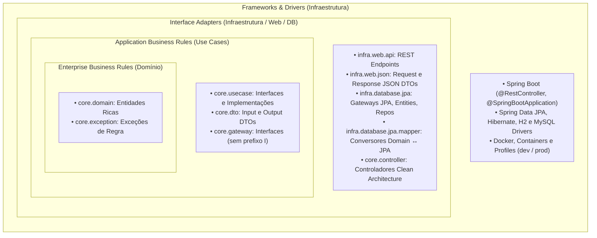
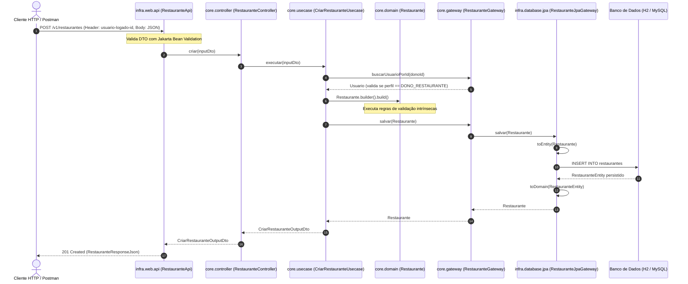

# Restaurantes Backend API — Tech Challenge Fase 2


[](https://opensource.org/licenses/MIT)

> **Pós Tech em Arquitetura e Desenvolvimento em JAVA - FIAP**  
> Projeto desenvolvido como requisito e instrumento de avaliação para o **Tech Challenge da Fase 2**  
> Turma **13ADJT**  
> Grupo **9**  
> ... Integrantes (1) : Alceu Luís de Andrade Melo

---

## 📌 Sumário
1. [Visão Geral do Projeto](#-visão-geral-do-projeto)
2. [Stack Tecnológica e Ferramentas](#-stack-tecnológica-e-ferramentas)
3. [Arquitetura da Aplicação (Clean Architecture)](#-arquitetura-da-aplicação-clean-architecture)
4. [Diretrizes e Regras de Negócio Mandatórias](#-diretrizes-e-regras-de-negócio-mandatórias)
5. [Estrutura de Diretórios](#-estrutura-de-diretórios)
6. [Como Executar o Projeto](#-como-executar-o-projeto)
   - [Opção 1: Execução Local com Maven (Banco H2 em Memória)](#opção-1-execução-local-com-maven-desenvolvimento-com-h2)
   - [Opção 2: Execução com Docker Compose (Deploy com MySQL 8)](#opção-2-execução-com-docker-compose-deploy-produção-com-mysql)
7. [Documentação Interativa (Swagger / OpenAPI)](#-documentação-interativa-swagger--openapi)
8. [Console do Banco H2 em Memória](#-console-do-banco-h2-em-memória)
9. [Testando com Postman (Collection Runner & Newman)](#-testando-com-postman-collection-runner--newman)
10. [Testes Automatizados e Cobertura (JUnit 5 + JaCoCo)](#-testes-automatizados-e-cobertura-junit-5--jacoco)
11. [Catálogo Completo de Endpoints da API](#-catálogo-completo-de-endpoints-da-api)
12. [Tratamento Global de Erros e Exceções](#-tratamento-global-de-erros-e-exceções)
13. [Licença](#-licença)

---

## 🎯 Visão Geral do Projeto

O **Restaurantes Backend** é uma API REST desenvolvida em **Java com Spring Boot**, estruturada sob os princípios estritos de **Clean Architecture**, **Clean Code**, **SOLID** e **TDD**. O sistema implementa uma plataforma corporativa compartilhada para gestão de redes e estabelecimentos gastronômicos, cobrindo:

- **CRUD de Tipos de Usuário**: Gestão com subtipos tipados obrigatoriamente através do enum `TipoUsuarioEnum` (`Dono de restaurante` e `Cliente`).
- **CRUD de Restaurantes**: Estabelecimentos vinculados a seus respectivos proprietários, com regras estritas de edição exclusiva pelo Dono.
- **CRUD de Itens do Cardápio**: Pratos e bebidas associados ao restaurante proprietário, com controle de visualização aberta a Clientes e edição restrita ao Dono.
- **Multi-Tenancy Lógico**: Isolamento absoluto entre estabelecimentos por `restaurante_id`.
- **Segurança Sem Spring Security**: Controle de acesso por cabeçalho HTTP `usuario-logado-id` e validações de papéis manuais no domínio.
- **Auditoria Universal e Soft Delete**: Nenhuma exclusão física no banco de dados (`ativo = true/false`) e registro automático de criação/alteração (`data_criacao`, `data_alteracao`).
- **Identificadores UUID Universais**: Todos os IDs do sistema utilizam `java.util.UUID` (`VARCHAR(36)`), sem identificadores numéricos ou auto-incremento.

---

## 🚀 Stack Tecnológica e Ferramentas

| Componente | Tecnologia | Detalhes |
| :--- | :--- | :--- |
| **Linguagem** | Java 21 LTS | Versão LTS moderna com suporte a Pattern Matching e Records |
| **Framework Base** | Spring Boot 3.x+ | Spring Web MVC, Spring Data JPA, Jakarta Bean Validation |
| **Arquitetura** | Clean Architecture | Isolamento total do Core (independente de frameworks e JPA) |
| **Banco de Dados (Dev/Testes)** | H2 Database | Em memória, modo MySQL (`jdbc:h2:mem:restaurantes_db;MODE=MySQL`) |
| **Banco de Dados (Deploy/Prod)** | MySQL 8.x | Conteinerizado via Docker Compose com healthcheck nativo |
| **Documentação da API** | Springdoc OpenAPI / Swagger | UI interativa em `/swagger-ui.html` e especificações OpenAPI v3 |
| **Testes Automatizados** | JUnit 5 + Mockito + AssertJ | Testes unitários do Core e testes E2E com `MockMvc` |
| **Cobertura de Código** | JaCoCo 0.8.13 | > 97% de cobertura (superando o critério obrigatório de 80%) |
| **Postman Collection** | Postman v2.1 + Newman | 34 requisições, 64 asserções automatizadas, 100% idempotente |
| **Containerização** | Docker & Docker Compose | Dockerfile multi-stage com imagem leve JRE |
| **Produtividade** | Lombok | Redução de boilerplate em DTOs e entidades |

---

## 🏗 Arquitetura da Aplicação (Clean Architecture)

A aplicação segue rigorosamente o princípio da **Inversão de Dependência (DIP)** e a **Regra de Dependência** da Clean Architecture: o núcleo de negócio (*Core*) não conhece detalhes técnicos, bibliotecas de terceiros ou frameworks.



### 🔄 Diagrama de Fluxo de Chamadas



---

## 🛡️ Diretrizes e Regras de Negócio Mandatórias

1. **Sem Spring Security**:
   - Não são utilizadas dependências de autenticação mágica ou filtros do Spring Security.
   - O controle de acesso é realizado estritamente pela presença do cabeçalho HTTP:
     ```http
     usuario-logado-id: <UUID_DO_OPERADOR>
     ```
   - O Core valida se o operador existe, está ativo e se possui permissão legítima para a operação (ex: apenas o Dono pode editar dados do seu restaurante e de seu cardápio).
2. **Multi-Tenancy Lógico Estrito**:
   - Cada usuário pertence a um único restaurante.
   - Operadores de um restaurante não conseguem alterar cardápios de outros estabelecimentos (gerando `403 Forbidden`).
3. **Subtipos em Enum Type-Safe**:
   - Os subtipos de usuário são governados pelo enum `TipoUsuarioEnum` (`DONO_RESTAURANTE` com descrição `"Dono de restaurante"` e `CLIENTE` com descrição `"Cliente"`).
4. **Soft Delete Universal**:
   - Nenhuma exclusão física ocorre no banco. Exclusões alteram `ativo = false`, e consultas regulares filtram apenas registros ativos.
5. **Auditoria Obrigatória**:
   - Todas as tabelas e entidades rastreiam `data_criacao` e `data_alteracao` via `LocalDateTime`.
6. **100% Identificadores UUID**:
   - Todos os IDs são gerados e trafegados no formato UUID v4 (`java.util.UUID`).

---

## 📂 Estrutura de Diretórios

```text
restaurantes-backend-fase2/
├─ docs/
│  └─ postman/
│     └─ restaurantes-api.postman_collection.json  # Postman Collection v2.1 completa
├─ src/
│  ├─ main/
│  │  ├─ java/br/com/fiap/fase2tc/restaurantes_backend_fase2/
│  │  │  ├─ core/                        # Camadas internas (independente de frameworks)
│  │  │  │  ├─ controller/               # Controladores Clean Architecture puros
│  │  │  │  ├─ domain/                   # Entidades de Domínio e Enums
│  │  │  │  ├─ dto/                      # Input e Output DTOs dos Use Cases
│  │  │  │  ├─ exception/                # Exceções de negócio (extensões de SystemBaseException)
│  │  │  │  ├─ gateway/                  # Contratos de persistência (SEM prefixo 'I')
│  │  │  │  └─ usecase/                  # Casos de uso e regras de aplicação
│  │  │  └─ infra/                       # Camadas externas (Interface Adapters e Frameworks)
│  │  │     ├─ config/                   # Injeção manual de Beans e configuração OpenAPI
│  │  │     ├─ database/
│  │  │     │  ├─ jpa/                   # Entidades JPA, Repositories e Gateways
│  │  │     │  └─ jpa/mapper/            # Mapeadores entre Domínio e JPA
│  │  │     └─ web/
│  │  │        ├─ api/                   # Endpoints REST (@RestController)
│  │  │        ├─ handler/               # GlobalExceptionHandler (exceções → HTTP 4xx/5xx)
│  │  │        └─ json/                  # Payloads Request e Response HTTP
│  │  └─ resources/
│  │     ├─ application.yml              # Configuração padrão e perfil dev (H2 em memória)
│  │     ├─ application-prod.yml         # Perfil de produção/deploy (MySQL 8)
│  │     └─ data.sql                     # Carga inicial (seeds) executada no H2 em dev; schema gerado pelo Hibernate
│  └─ test/                              # Testes automatizados (Unitários e E2E)
│     └─ java/br/com/fiap/fase2tc/restaurantes_backend_fase2/
│        ├─ core/                        # Testes Unitários puros (UseCases e Domínio)
│        └─ infra/                       # Testes de Integração E2E (@SpringBootTest com H2)
├─ Dockerfile                            # Multi-stage build para deploy otimizado
├─ docker-compose.yml                    # Orquestração da API e MySQL 8 com healthcheck
├─ infra/scripts/init.sql                # Schema e seeds do MySQL 8 (Docker)
├─ pom.xml                               # Dependências Maven e plugin JaCoCo
└─ README.md                             # Documentação técnica do projeto
```

---

## 🛠️ Como Executar o Projeto

### Pré-requisitos
- **Para Desenvolvimento Local**: JDK 21 LTS e Maven (não requer Docker nem MySQL).
- **Para Deploy em Container**: Docker e Docker Compose instalados.

---

### Opção 1: Execução Local com Maven (Desenvolvimento com H2)

A aplicação utiliza por padrão o perfil `dev`, executando o banco **H2 Database em memória** configurado em compatibilidade com o MySQL. O schema é gerado pelo Hibernate (`ddl-auto: create-drop`) e o `data.sql` com os seeds é executado automaticamente na inicialização.

```bash
# Clone o repositório
git clone https://github.com/AlceuMelo-Fiap-PosTech-13ADJT/restaurantes-backend-fase2.git
cd restaurantes-backend-fase2

# 1. Executar os testes automatizados com validação de cobertura (mínimo de 80%)
./mvnw test

# 2. Iniciar a aplicação localmente
./mvnw spring-boot:run
```

- A API estará disponível em: **`http://localhost:8080`**
- O Swagger UI interativo estará acessível em: **`http://localhost:8080/swagger-ui.html`**
- O console do banco H2 estará acessível em: **`http://localhost:8080/h2-console`**

---

### Opção 2: Execução com Docker Compose (Deploy / Produção com MySQL)

Para subir o ambiente completo de produção conteinerizado com a aplicação conectada a um serviço **MySQL 8 oficial**:

```bash
# Na raiz do projeto, execute o build e a inicialização dos containers
docker compose up --build
```

O `docker-compose.yml` garante a orquestração:
1. O container `mysql` sobe o MySQL 8, cria o banco `restaurantes_db` e executa um `healthcheck` via `mysqladmin ping`.
2. O container `app` aguarda o MySQL ficar totalmente saudável (`condition: service_healthy`) antes de inicializar o Spring Boot com o perfil `prod`.

Para encerrar a execução e remover os containers:
```bash
docker compose down
```

---

## 📖 Documentação Interativa (Swagger / OpenAPI)

Com a aplicação em execução (localmente ou via Docker), a especificação completa da API pode ser explorada interativamente no navegador:

- **Swagger UI**: [http://localhost:8080/swagger-ui.html](http://localhost:8080/swagger-ui.html)
- **OpenAPI 3 JSON**: [http://localhost:8080/v3/api-docs](http://localhost:8080/v3/api-docs)

A documentação apresenta descrições ricas, parâmetros obrigatórios, schemas de DTOs e exemplos de respostas para códigos de sucesso (200, 201, 204) e erro (400, 403, 404, 422).

---

## 🗄️ Console do Banco H2 em Memória

Durante a execução no perfil `dev`, o console do H2 permite inspecionar tabelas, registros e auditoria em tempo real:

- **URL de Acesso**: [http://localhost:8080/h2-console](http://localhost:8080/h2-console)
- **Parâmetros de Conexão**:
  - **Driver Class**: `org.h2.Driver`
  - **JDBC URL**: `jdbc:h2:mem:restaurantes_db`
  - **User Name**: `sa`
  - **Password**: *(em branco)*

---

## 📮 Testando com Postman (Collection Runner & Newman)

Uma collection completa, padronizada no formato **Postman Collection v2.1**, está versionada e pronta para uso em:  
📁 [`docs/postman/restaurantes-api.postman_collection.json`](docs/postman/restaurantes-api.postman_collection.json)

### 📂 Estrutura de Pastas da Collection:
1. `Tipos de Usuario` (6 requisições): Listagem, busca por ID, validação de cadastro, atualização, desativação e associação a usuários.
2. `Usuarios` (6 requisições): Criação com dados dinâmicos, busca por ID, listagem por restaurante (multi-tenancy), atualização, associação de tipo e soft delete.
3. `Restaurantes` (5 requisições): Criação com UUID, listagem geral, consulta por ID, atualização cadastral por Dono e soft delete seguro.
4. `Cardapio` (5 requisições): Inclusão de prato por Dono, listagem pública para Clientes, consulta por ID, alteração de item e soft delete.
5. `Cenários de erro e validação` (15 requisições): Testes estritos de segurança sem Spring Security (header ausente 400, payload inválido 400, UUID malformado 400, cliente criando restaurante 403, cliente criando tipo de usuário 403, cliente criando usuário 403, invasão cross-tenant no cadastro de usuário 403, usuário não-dono alterando restaurante 403, cliente editando cardápio 403, invasão cross-tenant no cardápio 403, recursos inexistentes 404, subtipos inválidos no enum 422 e e-mail duplicado 422).

### 🚀 Execução pelo Collection Runner do Postman
1. Abra o **Postman** e clique em **Import** (canto superior esquerdo).
2. Selecione o arquivo `docs/postman/restaurantes-api.postman_collection.json`.
3. Na collection importada, clique nos três pontinhos (`...`) e selecione **Run collection**.
4. Mantenha a ordem das pastas e clique no botão azul **Run Restaurantes API - Fase 2**.
5. Todas as **70 asserções** serão executadas com 100% de sucesso.

### 💻 Execução via Terminal (Newman)
Caso queira executar os testes da API diretamente no terminal ou em pipelines CI/CD:
```bash
# Executa a collection e exibe o relatório formatado no console
npx --yes newman run docs/postman/restaurantes-api.postman_collection.json
```

---

## 🧪 Testes Automatizados e Cobertura (JUnit 5 + JaCoCo)

O projeto adota a disciplina de testes automatizados com os princípios **F.I.R.S.T.**, cobrindo testes unitários de regras de negócio puras e testes de integração de ponta a ponta (E2E) simulando requisições HTTP reais com `MockMvc` e banco em memória:

```bash
# Executa toda a suíte de testes unitários e de integração
./mvnw test
```

### 📈 Indicadores de Qualidade e Cobertura (Critério Obrigatório de 80%)

| Métrica JaCoCo | Percentual Alcançado | Meta Mínima Obrigatória | Status |
| :--- | :---: | :---: | :---: |
| **Instruções (Instructions)** | **96.88%** | 80.00% | ✅ Aprovado com Louvor |
| **Linhas de Código (Lines)** | **97.20%** | 80.00% | ✅ Aprovado com Louvor |
| **Ramificações (Branches)** | **84.95%** | 80.00% | ✅ Aprovado com Louvor |
| **Total de Testes Automatizados** | **437 testes** | — | ✅ 100% Sucesso (0 falhas) |

O relatório visual completo gerado pelo JaCoCo pode ser inspecionado após a execução em:  
`target/site/jacoco/index.html`

---

## 📋 Catálogo Completo de Endpoints da API

Todas as operações protegidas exigem o cabeçalho HTTP: `usuario-logado-id: <UUID>`.

### 1. Módulo: Tipos de Usuário (`/v1/tipos-usuario`)

| Método | Endpoint | Cabeçalho Obrigatório | Descrição / Payload | Respostas |
| :--- | :--- | :--- | :--- | :--- |
| **GET** | `/v1/tipos-usuario` | `usuario-logado-id` | Retorna todos os tipos de usuário ativos. | `200` |
| **GET** | `/v1/tipos-usuario/{id}` | `usuario-logado-id` | Detalhes de um tipo de usuário por UUID. | `200`, `400`, `404` |
| **POST** | `/v1/tipos-usuario` | `usuario-logado-id` | Cria tipo (`{"nome": "Dono de restaurante" \| "Cliente"}`). **Restrito a Dono**. | `201`, `400`, `403`, `422` |
| **PUT** | `/v1/tipos-usuario/{id}` | `usuario-logado-id` | Atualiza o nome do tipo de usuário existente. **Restrito a Dono**. | `200`, `400`, `403`, `404`, `422` |
| **DELETE** | `/v1/tipos-usuario/{id}` | `usuario-logado-id` | Desativação lógica (soft delete) do tipo. **Restrito a Dono**. | `204`, `400`, `403`, `404` |
| **POST** | `/v1/tipos-usuario/usuarios/{usuarioId}/associar` | `usuario-logado-id` | Associa um tipo ao usuário (`{"tipoUsuarioId": "UUID"}`). **Restrito a Dono**. | `200`, `400`, `403`, `404`, `422` |

---

### 2. Módulo: Usuários (`/v1/usuarios`)

| Método | Endpoint | Cabeçalho Obrigatório | Descrição / Payload | Respostas |
| :--- | :--- | :--- | :--- | :--- |
| **POST** | `/v1/usuarios` | `usuario-logado-id` | Cadastra usuário (`nome`, `email`, `tipoUsuarioId`, `restauranteId`). **Restrito ao Dono do restaurante**. | `201`, `400`, `403`, `404`, `422` |
| **GET** | `/v1/usuarios/{id}` | `usuario-logado-id` | Retorna os detalhes de um usuário por UUID. | `200`, `400`, `404` |
| **GET** | `/v1/usuarios/restaurante/{restauranteId}` | `usuario-logado-id` | Lista usuários do restaurante. **Restrito ao Dono do restaurante**. | `200`, `400`, `403`, `404` |
| **PUT** | `/v1/usuarios/{id}` | `usuario-logado-id` | Atualiza dados cadastrais. Permitido ao próprio usuário ou ao Dono. | `200`, `400`, `403`, `404`, `422` |
| **POST** | `/v1/usuarios/{usuarioId}/tipo-usuario` | `usuario-logado-id` | Vincula perfil ao usuário. **Restrito ao Dono do restaurante**. | `200`, `400`, `403`, `404`, `422` |
| **DELETE** | `/v1/usuarios/{id}` | `usuario-logado-id` | Desativação lógica de usuário. Permitido ao próprio usuário ou ao Dono. | `204`, `400`, `403`, `404` |

---

### 3. Módulo: Restaurantes (`/v1/restaurantes`)

| Método | Endpoint | Cabeçalho Obrigatório | Descrição / Payload | Respostas |
| :--- | :--- | :--- | :--- | :--- |
| **POST** | `/v1/restaurantes` | `usuario-logado-id` | Cadastra restaurante (`nome`, `endereco`, `tipoCozinha`, `horarioFuncionamento`, `donoId`). Valida se o operador no header e donoId possuem perfil `DONO_RESTAURANTE`. | `201`, `400`, `403`, `422` |
| **GET** | `/v1/restaurantes` | `usuario-logado-id` | Lista todos os restaurantes ativos. | `200`, `400` |
| **GET** | `/v1/restaurantes/{id}` | `usuario-logado-id` | Retorna os dados completos do restaurante por UUID. | `200`, `400`, `404` |
| **PUT** | `/v1/restaurantes/{id}` | `usuario-logado-id` | Atualiza restaurante. **Restrito exclusivamente ao dono** cadastrado. | `200`, `400`, `403`, `404`, `422` |
| **DELETE** | `/v1/restaurantes/{id}` | `usuario-logado-id` | Desativação lógica do restaurante. **Restrito ao dono**. | `204`, `400`, `403`, `404` |

---

### 4. Módulo: Cardápio (`/v1/restaurantes/{restauranteId}/cardapio`)

| Método | Endpoint | Cabeçalho Obrigatório | Descrição / Payload | Respostas |
| :--- | :--- | :--- | :--- | :--- |
| **POST** | `/v1/restaurantes/{restauranteId}/cardapio` | `usuario-logado-id` | Cadastra item no cardápio (`nome`, `descricao`, `preco`, `disponivelApenasRestaurante`, `fotoPath`). **Restrito ao dono do restaurante**. | `201`, `400`, `403`, `404`, `422` |
| **GET** | `/v1/restaurantes/{restauranteId}/cardapio` | `usuario-logado-id` | Lista itens ativos do cardápio do restaurante. **Acesso liberado para Clientes**. | `200`, `400`, `404` |
| **GET** | `/v1/restaurantes/{restauranteId}/cardapio/{itemId}` | `usuario-logado-id` | Retorna dados de um prato específico do cardápio. | `200`, `400`, `404` |
| **PUT** | `/v1/restaurantes/{restauranteId}/cardapio/{itemId}` | `usuario-logado-id` | Atualiza item do cardápio. **Restrito ao dono**. | `200`, `400`, `403`, `404`, `422` |
| **DELETE** | `/v1/restaurantes/{restauranteId}/cardapio/{itemId}` | `usuario-logado-id` | Exclusão lógica (soft delete) do prato. **Restrito ao dono**. | `204`, `400`, `403`, `404` |

---

## ⚠️ Tratamento Global de Erros e Exceções

O tratamento de exceções é centralizado no `GlobalExceptionHandler` (`infra.web.handler`), interceptando erros da camada web e exceções de negócio do domínio e convertendo-as em respostas padronizadas em JSON (`ErroResponseJson`):

| Exceção de Domínio / Infraestrutura | Código HTTP | Significado e Causa |
| :--- | :---: | :--- |
| `MethodArgumentNotValidException` | **400 Bad Request** | Violação de Bean Validation em campos obrigatórios do body. |
| `MissingRequestHeaderException` | **400 Bad Request** | Cabeçalho obrigatório `usuario-logado-id` ausente. |
| `MethodArgumentTypeMismatchException` | **400 Bad Request** | Formato de UUID inválido informado nos parâmetros da URL. |
| `AcessoNaoAutorizadoException` | **403 Forbidden** | Operador não é o dono do restaurante ou usuário está inativo. |
| `DonoRestauranteInvalidoException` | **403 Forbidden** | Usuário associado como dono não possui o perfil Dono de restaurante. |
| `RecursoNaoEncontradoException` | **404 Not Found** | Restaurante, item de cardápio, usuário ou tipo inexistente. |
| `RegraNegocioException` | **422 Unprocessable Entity** | Violação de regra de negócio (e-mail duplicado, subtipo inválido). |
| `Exception` (Genérica) | **500 Internal Server Error** | Erro interno não tratado de infraestrutura. |

### Exemplo de Resposta de Erro (400 Bad Request com validação de campos):
```json
{
  "status": 400,
  "mensagem": "Erro de validação nos campos informados.",
  "timestamp": "2026-10-25T19:00:00",
  "erros": [
    "nome: O nome do restaurante é obrigatório.",
    "endereco: O endereço é obrigatório.",
    "tipoCozinha: O tipo de cozinha é obrigatório."
  ]
}
```

---

## 📄 Licença

Este projeto é desenvolvido para fins acadêmicos e distribuído sob os termos da licença [MIT License](https://opensource.org/licenses/MIT).

*© 2026 Alceu Luís de Andrade Melo — FIAP Pós Tech*
